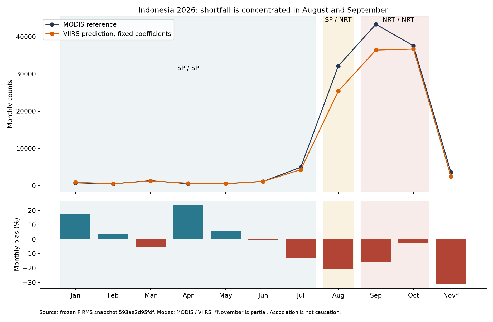
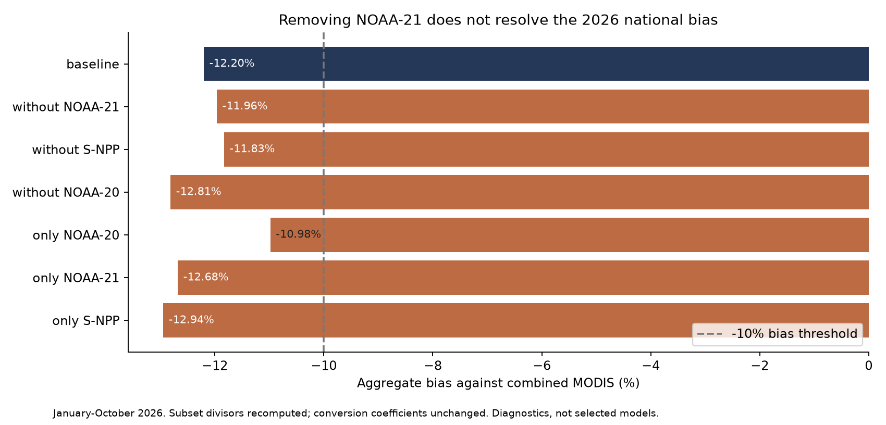
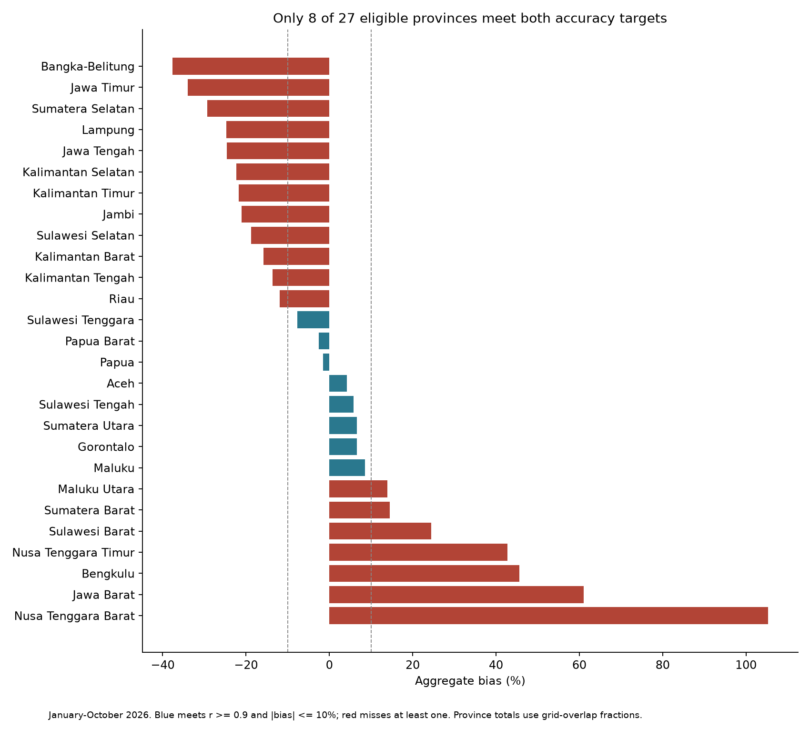

# Indonesia bias audit: completed diagnostics, unchanged model

Snapshot `593ae2d95fdf`; analysis performed 14 November 2026 on
`feat/firms-api-acquisition` after fetching `568b9db`. This report completes the
handover's diagnostic stage. It does not claim that a scientifically validated
correction has been found.

**Result:** the national January-October 2026 prediction is 12.20% below the
combined MODIS reference, and only 8 of 27 eligible provinces meet both targets.
Most of the net shortfall is in August and September. Removing NOAA-21 does not
resolve it. Exposure evidence is now available, but cannot support a reliable
valid-observation correction by itself. The existing model is retained.

## Terms used in this report

- **Prediction:** VIIRS detections converted using the snapshot's fixed cell
  coefficients and monthly satellite divisor. It is not a fire forecast.
- **Bias:** `(total prediction - total MODIS reference) / total MODIS reference`.
  A negative value means the converted series is lower than that reference.
- **SP / NRT:** standard-processed / near-real-time observations. NRT is provisional.
- **Exposure:** valid opportunities for a satellite to observe an area. Detection
  counts, successful requests and a missing-day flag do not measure it directly.
- **r:** correlation of monthly totals. High correlation can coexist with a
  substantial scale error. Targets here require r >= 0.9 and |bias| <= 10%.

MODIS is a comparison reference with its own limitations, not ground-truth fire
incidents or burned area. All examined periods are already known outcomes.

## Input and baseline verification

Both supplied ZIPs matched `SHA256SUMS.txt`. Per-file verification passed for all
52 processed files and 991 source/provenance files before extraction into empty
destinations. The retained snapshot contains 7,716,551 detections across 313
months, through 14 November 2026.

The audit then:

1. Verified 463 saved responses and their receipts against the eight-source plan.
2. Reconciled retained platform/source/date counts with the snapshot's reports.
3. Checked 108,102 occupied cell-months in the 83 diagnostic months against
   point counts and the globally computed satellite divisors: zero mismatches.
4. Reproduced all 102 saved regression rows: Indonesia plus all 33 source
   provinces, for the three original reporting periods. Eligibility was unchanged.
5. Reconciled point weights with the harmonized cube: maximum absolute numerical
   difference `3.38e-11`, below the `1e-8` acceptance threshold.
6. Rechecked every frozen audit input before publishing figures/tables.

No input snapshot report was rewritten. API/calendar/statistics/points/CSV
checks passed for Riau, Sumatera Selatan and Kalimantan Tengah, including the
partial November month. Metadata and globe checks passed too. This establishes
technical consistency, not that the accuracy targets are met.

Transfer checksums are in [package-transfer.json](reports/bias-audit-20261114/package-transfer.json).
The [input manifest](reports/bias-audit-20261114/input-manifest.json) records
input/code hashes, configuration and runtime. Full local outputs remain in
`data/interim/bias-audit-20261114/`; small reviewable tables and figures are
published under [the report artifact directory](reports/bias-audit-20261114/).

## 1. Where the 2026 shortfall occurs

| Period | MODIS reference | Fixed-coefficient VIIRS prediction | Bias | r |
| --- | ---: | ---: | ---: | ---: |
| January-July | 9,706 | 9,299.49 | -4.19% | 0.9992 |
| August | 32,159 | 25,396.85 | -21.03% | Not estimable: one month |
| September-October | 80,913 | 73,100.70 | -9.66% | Not estimable: two months |
| January-October | 122,778 | 107,797.04 | -12.20% | 0.9944 |
| November 1-14, partial | 3,551 | 2,436.38 | -31.39% | Not estimable: one partial month |

Source: [national-periods.csv](reports/bias-audit-20261114/national-periods.csv).

The January-October net shortfall is **14,980.96 MODIS-equivalent counts**.
August contributes -6,762.15 and September -6,941.50, together **91.47% of that
net shortfall**. This is a signed accounting share: positive residuals in some
other months offset part of the negative residual. It is not a causal allocation.



The source composition actually present in the points confirms the handover:

| 2026 months | MODIS | VIIRS |
| --- | --- | --- |
| January-July | SP, version `61.03` | SP, version `2` |
| August | SP, version `61.03` | NRT, version `2.0NRT` |
| September-November | NRT, version `6.1NRT` | NRT, version `2.0NRT` |

The record-level counts and versions are in
[source-composition-2026.csv](reports/bias-audit-20261114/source-composition-2026.csv).

**Interpretation:** the largest deficit coincides with the transition into
provisional observations and an intense fire season. These are not matched
SP/NRT observations of the same dates. Season, spatial fire distribution,
instrument sampling and processing mode remain confounded. A -21.03% August
bias is not evidence that the NRT algorithm alone causes a 21.03% loss.

## 2. No individual satellite exclusion solves the full-period problem

All scenarios retain the same cell coefficients. A subset's divisor is recomputed
from the same retained VIIRS platform subset, globally per month before AOI
weighting.

| Scenario | National Jan-Oct bias | r | Eligible provinces meeting both targets |
| --- | ---: | ---: | ---: |
| All three VIIRS platforms | -12.20% | 0.9944 | 8/27 |
| Without NOAA-21 | -11.96% | 0.9948 | 8/27 |
| Without S-NPP | -11.83% | 0.9930 | 9/27 |
| Without NOAA-20 | -12.81% | 0.9950 | 6/27 |
| NOAA-20 only | -10.98% | 0.9925 | 7/27 |
| NOAA-21 only | -12.68% | 0.9929 | 6/27 |
| S-NPP only | -12.94% | 0.9965 | 7/27 |

Removing NOAA-21 improves national bias by only **0.239 percentage points**.
None of these national diagnostics crosses the -10% bias boundary. Selecting
the best-looking subset after reading these outcomes would reuse known results
for selection; no subset is promoted.



Source: [satellite-sensitivity.csv](reports/bias-audit-20261114/satellite-sensitivity.csv),
which also contains every province and baseline-relative changes.

The accounting table in the full local audit preserves each platform, processing
source and original version. MODIS observations contribute negatively to the
residual, VIIRS converted observations positively. Their sum reproduces the
baseline residual; this decomposition does not identify an instrument defect.

## 3. Regional transfer remains the larger unresolved accuracy problem

| Pilot province | Known 2016/2019 bias | Known 2022-2025 bias | Jan-Oct 2026 bias | 2026 r |
| --- | ---: | ---: | ---: | ---: |
| Riau | -13.69% | -40.18% | -11.89% | 0.9796 |
| Sumatera Selatan | -12.82% | -12.82% | -29.25% | 0.9955 |
| Kalimantan Tengah | -9.39% | -13.33% | -13.67% | 0.9849 |

All three pilot provinces miss the 2026 combined target despite high correlation.
Sumatera Selatan remains roughly 29% low under each single-platform diagnostic:
NOAA-20 -28.64%, NOAA-21 -29.29%, S-NPP -29.81%. This weakens the explanation
that adding NOAA-21 alone caused that province's deficit; it does not isolate
the alternative cause.

The largest weighted provincial residuals include Kalimantan Tengah (-4,312.40),
Sumatera Selatan (-3,585.34), Kalimantan Barat (-2,943.37), Kalimantan Timur
(-1,751.78) and Kalimantan Selatan (-1,239.38). Province results use grid-cell
intersection fractions. They must not be summed as an exact partition of the
national point-centre country-mask result.



Source: [regional-periods.csv](reports/bias-audit-20261114/regional-periods.csv).
All 33 source provinces are reported; eligibility remains the pre-existing
>=1,000 weighted training-MODIS-count rule, which yields 27 eligible provinces.
The source boundary set is historical and does not describe every current
administrative division.

## 4. The historical aggregate conceals substantial yearly variation

| Known period | National bias | r | Eligible provincial passes |
| --- | ---: | ---: | ---: |
| 2016 and 2019 | -6.20% | 0.9992 | 12/27 |
| 2022 | +12.20% | 0.9777 | 3/27 |
| 2023 | -8.80% | 0.9972 | 11/27 |
| 2024 | -4.55% | 0.9916 | 8/27 |
| 2025 | +9.38% | 0.9837 | 4/27 |
| 2022-2025 pooled | -2.88% | 0.9949 | 9/27 |

The small pooled national bias does not establish stable yearly or provincial
transfer. Positive and negative yearly errors partially cancel. These are
descriptive regression checks of already observed data, not new hold-out tests.

## 5. The exposure branch now has actual NASA evidence

The public missing-data page loads its rows using
[`?action=fetch_data`](https://firms.modaps.eosdis.nasa.gov/api/missing_data/?action=fetch_data).
That request succeeded at **22:35:40 Jakarta time on 14 November 2026**. The
response contains 169 HTML rows representing two independent column lists,
which parse to **178 satellite/source/date records**, not 169 paired cases.

The [page documentation](https://firms.modaps.eosdis.nasa.gov/api/missing_data/)
describes database missing-day records and limits the scope of its NRT list by
standard-data availability. An absent flag does not establish full coverage.
The previously observed loading failure was a limitation of the initial page
view, not proof that NASA had no accessible records.

The evidence audit joins those records, with source modes kept separate, to
1,590 platform-days in the 2026 snapshot window:

- 46 matching 2026 missing-day flags: 45 S-NPP SP and one Terra SP.
- 31 flagged S-NPP days in May contain **2,889 retained SP detections**.
- All 31 May days have detections even though all are flagged as missing-data days.
- The other 15 matching flagged days have no retained detections here; that
  absence alone does not quantify the unobserved area or overpass opportunities.

The 2026 S-NPP flags cover March 10-12, April 28-30, May 1-31, June 1-2 and
July 11-16; the Terra flag is January 12. These describe the retrieved NASA
database record, not validated day-long Indonesia outages.

**Decision:** do not convert this inventory into a "fraction of valid days" or
divide counts by the number of days with detections. The May overlap demonstrates
why a whole-day interpretation is unsafe. Valid-observation swaths or equivalent
area/time/platform coverage evidence are still needed.

The cached response, its retrieval hash and derived records are retained in
[exposure-result.json](reports/bias-audit-20261114/exposure-result.json),
[nasa-missing-days.csv](reports/bias-audit-20261114/nasa-missing-days.csv), and
[daily-exposure-evidence.csv](reports/bias-audit-20261114/daily-exposure-evidence.csv).
The [compressed raw response](reports/bias-audit-20261114/nasa-missing-data-response.json.gz)
allows the parsing result to be checked without a new request.

## 6. November exposes a denominator sensitivity, not a January-October fix

The snapshot ends November 14, while saved S-NPP availability ends November 2.
Retained November counts are S-NPP 2,114; NOAA-20 16,740; NOAA-21 16,886. The
baseline divisor is still three because each platform has some detections.

| Partial November diagnostic | Prediction | Bias against the same partial MODIS window |
| --- | ---: | ---: |
| Baseline, all three | 2,436.38 | -31.39% |
| Without S-NPP, divisor recomputed to two | 3,433.99 | -3.30% |
| S-NPP alone | 441.17 | -87.58% |

This shows strong sensitivity to unequal platform date coverage in November.
It does not prove the physical reason for the availability cutoff, and dropping
a platform is not an exposure estimate. November was already excluded from the
January-October headline; its problem cannot explain that earlier deficit.

## 7. What the evidence supports next

| Finding | Supported action | Not established |
| --- | --- | --- |
| Baseline reproduced exactly within tolerance | Use this frozen snapshot as the diagnostic baseline | Real fire truth |
| August/September dominate the shortfall | Prioritize matched-source and seasonal/spatial checks there | NRT processing is the cause |
| NOAA-21 exclusion changes national bias little | Avoid treating NOAA-21 removal as the correction | All platforms are equivalent |
| Strong provincial errors under multiple platforms | Investigate regional calibration/transfer jointly | A particular regional model will pass |
| May gap flags coexist with daily detections | Require finer exposure evidence | Missing-day subtraction is valid |
| November has unequal platform date ranges | Keep it partial and test an evidence-based exposure divisor later | A whole-month accuracy pass |

No post-hoc global multiplier or satellite subset is installed. A multiplier
chosen to erase this known 2026 bias would not validate regional transfer.

The next step is now specified in [the prospective evaluation protocol](bias-evaluation-next.md)
and its [machine-readable proposal lock](bias-evaluation-next-lock.json). It
requires new exposure evidence and training-only model selection before any
candidate is chosen. Future evaluation is separated from every outcome already
read in this audit.

## Reproduction and artifacts

Use the verified transferred packages and the branch's locked Python environment.
Preserve the original snapshot; do not run a verifier that rewrites its reports
before checking the frozen manifest.

```powershell
.\.venv\Scripts\python.exe scripts/audit_indonesia_bias.py --check-inputs
# Use a fresh --out if the original completed audit already exists:
.\.venv\Scripts\python.exe scripts/audit_indonesia_bias.py --out data/interim/bias-audit-reproduction

# Prepare a local copy of the exact archived NASA HTTP response and its receipt:
@'
import gzip, json
from pathlib import Path
r = Path('docs/reports/bias-audit-20261114')
e = Path('data/interim/exposure-evidence-20261114')
e.mkdir(parents=True, exist_ok=True)
response, receipt = e/'nasa-missing-data-response.json', e/'retrieval.json'
if response.exists() or receipt.exists():
    raise FileExistsError('Preserve existing evidence or choose a new directory')
response.write_bytes(gzip.decompress((r/'nasa-missing-data-response.json.gz').read_bytes()))
receipt.write_text(json.dumps(json.loads((r/'exposure-result.json').read_text())['retrieval']))
'@ | .\.venv\Scripts\python.exe -

.\.venv\Scripts\python.exe scripts/audit_indonesia_exposure.py --out data/interim/exposure-reproduction
.\.venv\Scripts\python.exe scripts/report_indonesia_bias.py --audit data/interim/bias-audit-reproduction --exposure data/interim/exposure-reproduction --out data/interim/report-reproduction
```

The default exposure paths refer to the locally frozen retrieval files. A fresh
computer can use the report's cached raw response and the `retrieval` object in
`exposure-result.json` as its matching receipt. Complete numerical outputs remain
ignored under `data/interim`; the committed report includes small summary tables,
figures and provenance rather than the 7.7 million original detections.

The Windows test fixture now copies its small input when directory symlinks fail
with `WinError 1314`, while retaining symlinks where supported. Other filesystem
errors are still raised. This changes test portability, not model behavior.

The diagnostic stage is complete: every branch has results or an explicit
evidence limitation. Exposure correction, a newly selected model, prospective
accuracy and serving promotion remain future work under the new protocol.
